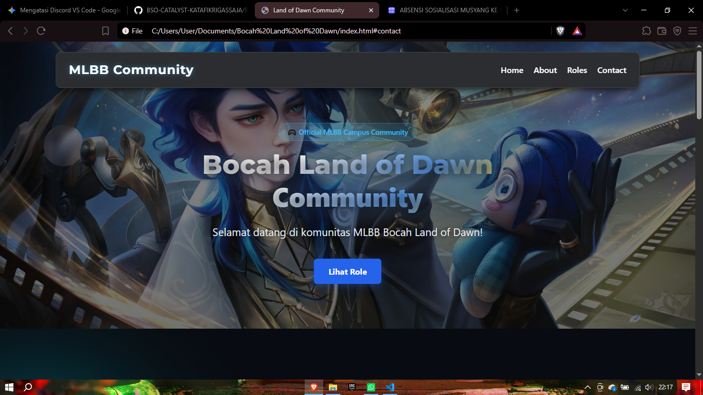
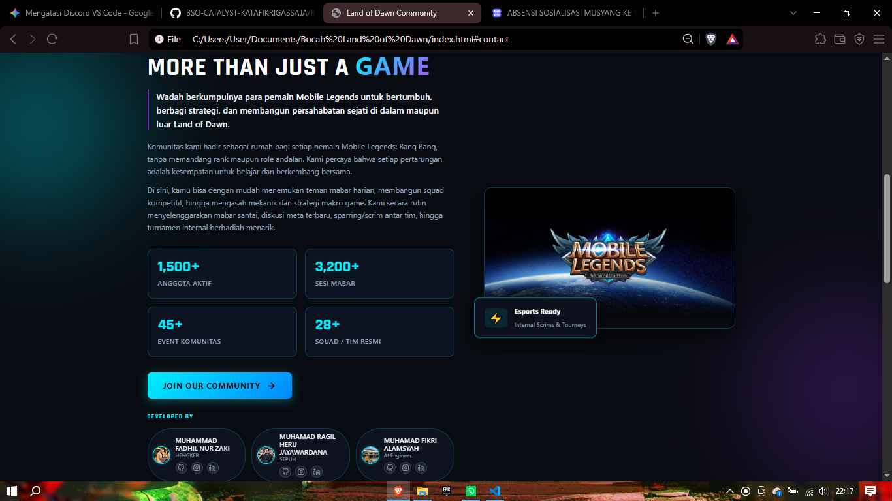
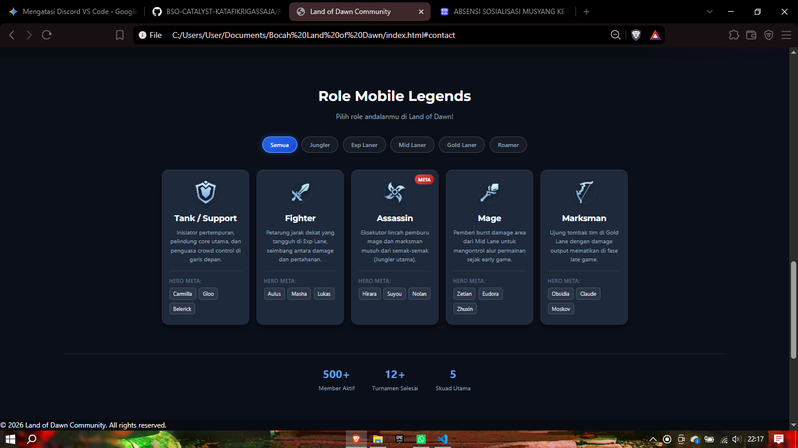
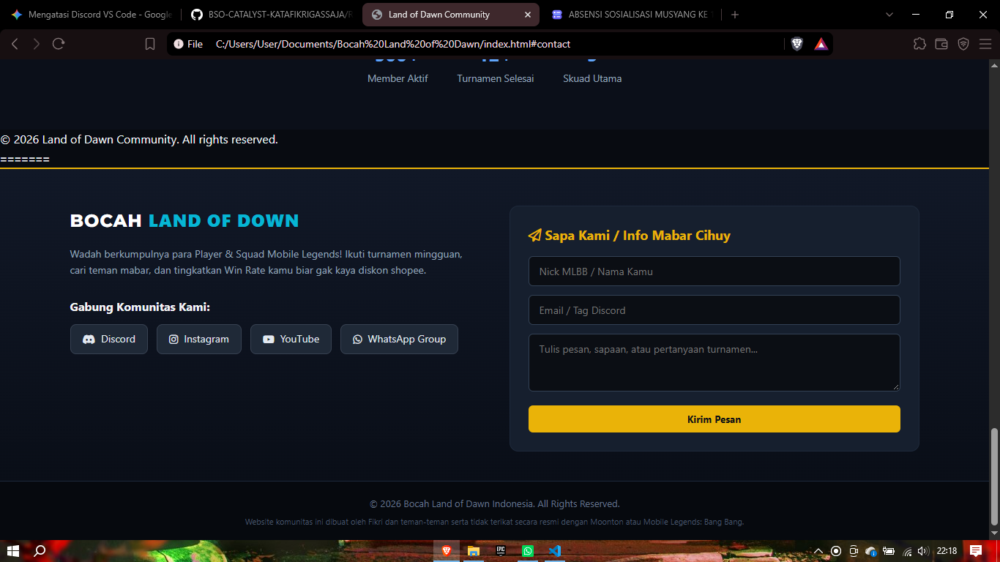

# BSO-CATALYST-KATAFIKRIGASSAJA
Membuat about yang berisi tentang latar belakang website ini

1. NAMA PROJECT :
  BOCAH LAND OF DOWN
2. DESC :
  WEBSITE KOMUNITAS BAGI ORANG ORANG YANG MEMILIKI MINAT ATAU HOBI BERMAIN MOBILE LEGEND
3. TUJUAN/LATAR BELAKANG PROJECT:
  MEWADAHI ORANG ORANG YANG MEMILIKI KEGEMARAN BERMAIN MOBILE LEGEND
4. FITUR/SECTION YANG TERSEDIA:
   a. Navbar & section hero
   b. Section Contact & Footer
   c. Section Main Content
   d. Section About
5. TEKNOLOGI YANG DIGUNAKAN:
  HTML & CSS
6. CARA MENJALANKAN WEBSITE SECARA LOKAL:
7. RINGKASAN PEMBAGIAN TUGAS DAN KONTRIBUSI ANGGOTA:
   a. Navbar & section hero (Ragil)
   b. Section Contact & Footer (Zaki)
   c. Section Main Content (Ragil)
   d. Section About (Fikri)

9. Anggota:
    a. Muhamad Ragil Heru Jayawardana (Muraru14)
     b. Muhamad Fikri Alamsyah (babikriukkk)
      c. Muhammad Fadhil Nur Zaki (Zakizakk)

## 📷 Dokumentasi Website

### 1. Hero Section

### 2. About Section

### 3. Main Content

### 4. Contact & Footer

